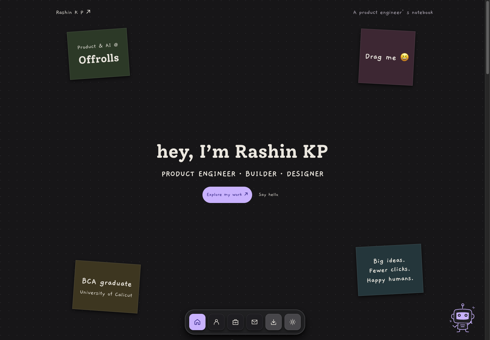

# Rashin KP | Developer Portfolio

Personal portfolio for Rashin KP, a full-stack developer focused on the MERN stack. It presents my professional experience, technical skills, education, and selected projects in a responsive interface with light and dark themes.

[Visit the live portfolio](https://rashinkp.vercel.app/)



## Features

- Professional experience at Offrolls
- Featured full-stack projects with live demos and source code
- Skills grouped across frontend, backend, data, cloud, integrations, and engineering
- Education and training history
- Downloadable résumé and direct contact links
- Light and dark themes with saved user preference
- Responsive layouts for desktop and mobile screens
- Scroll-based reveal animations with reduced-motion support
- Accessible components from the ASTRYX design system

## Built with

- React 19
- TypeScript
- Vite
- ASTRYX Design System
- StyleX
- Tailwind CSS
- Oxlint

## Featured projects

### focusebuddy

A personal focus and wellness companion with work session timers, water tracking, movement breaks, and date-range activity history. Built with React and TypeScript, with activity stored locally on the user’s device.

- [Live application](https://focusebuddy.vercel.app/)
- [Source code](https://github.com/rashinkp/focusebuddy)

### ByWay

A multi-role learning platform with tutor onboarding, OAuth, Stripe payments, real-time chat, notifications, and certificates.

- [Live application](https://byway-3yj3.onrender.com/)
- [Source code](https://github.com/rashinkp/byway)

### Mobilify

An e-commerce platform with secure checkout, wallet support, Razorpay payments, refunds, inventory management, and live order updates.

- [Live application](https://mobilify-two.vercel.app/)
- [Source code](https://github.com/rashinkp/mobilify)

## Run locally

Make sure Node.js and npm are installed, then run:

```bash
git clone https://github.com/rashinkp/rashi-portfolio.git
cd rashi-portfolio
npm install
npm run dev
```

Open the local URL shown by Vite in your browser.

## Available scripts

| Command | Purpose |
| --- | --- |
| `npm run dev` | Start the local development server |
| `npm run build` | Type-check and create a production build |
| `npm run lint` | Check the code with Oxlint |
| `npm run preview` | Preview the production build locally |

## Project structure

```text
.
├── public/
│   ├── favicon.svg
│   └── resume_rashin.pdf
├── src/
│   ├── components/  # Page header, footer, and sections
│   ├── data/        # Skills, experience, and projects
│   ├── hooks/       # Theme preference and scroll reveals
│   ├── App.tsx      # Page composition
│   ├── index.css
│   └── main.tsx
├── index.html
├── package.json
└── vite.config.ts
```

## Design system

The interface uses ASTRYX components and the neutral theme. Layout, spacing, color, typography, motion, elevation, and theme behavior follow the design system tokens instead of custom hardcoded values.

## Social sharing

The production URL is `https://rashinkp.vercel.app/`. Open Graph and Twitter large-image cards use `public/social-preview.jpg` (1200 × 630). The homepage is prerendered with a canonical URL, profile structured data, robots.txt, and a sitemap.

The `/chat` page has its own metadata and `noindex, follow` in its HTML and Vercel response headers. It stays crawlable so search engines can read that instruction and is excluded from the sitemap. Metadata also updates during client-side navigation. Run `npm run build && npm run test:prerender` to check the deployment output.

Fonts are self-hosted under `public/fonts/` with their licenses. Project thumbnails use WebP assets; the original PNGs are retained. Chat loads on pointer, keyboard, or click intent rather than automatically during homepage idle time.

## Contact

- [GitHub](https://github.com/rashinkp)
- [LinkedIn](https://www.linkedin.com/in/rashinkp/)
- [Email](mailto:rashinkp001@gmail.com)

## AI portfolio assistant

The portfolio includes a source-linked résumé chat using ASTRYX chat components, the Vercel AI SDK, Supabase pgvector/Edge Functions, and Gemini. It opens in preview mode until connected. Follow [the chat setup guide](docs/CHAT_SETUP.md) to configure secrets, deploy functions, and upload the reviewed knowledge.

Run `npm run knowledge:prepare` to review the content locally and `npm run test:chat` to check request validation and chunking. Knowledge scripts require Node.js 22.18 or later.
